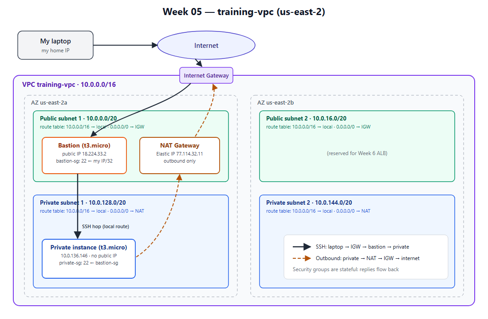

# Week 05: Networking (VPC Deep Dive)

Region: **us-east-2 (Ohio)**. My AWS Organization's SCP only allows this region; see the note at the bottom.



## What I built (Labs 5.1 + 5.2)

I built the same layout the console's "VPC and more" wizard creates, but step by step with the CLI so every piece is explicit: [build-vpc.sh](./build-vpc.sh).

| Resource | Value | Purpose |
| --- | --- | --- |
| VPC `training-vpc` | `10.0.0.0/16` (65,536 addresses) | My private network in AWS |
| Public subnets | `10.0.0.0/20` (us-east-2a), `10.0.16.0/20` (us-east-2b) | Things that must be reachable from the internet: bastion, NAT, later the ALB |
| Private subnets | `10.0.128.0/20` (us-east-2a), `10.0.144.0/20` (us-east-2b) | Things that must **not** be reachable from the internet: app servers, databases |
| Internet Gateway | attached to the VPC | Two-way door between the VPC and the internet |
| Public route table | `10.0.0.0/16 → local`, `0.0.0.0/0 → IGW` | This route is what *makes* a subnet "public" |
| NAT Gateway | in public subnet 2a, with an Elastic IP | Lets private instances make **outbound** connections (updates, APIs) with no inbound path |
| Private route tables (one per private subnet) | `10.0.0.0/16 → local`, `0.0.0.0/0 → NAT` | Explicitly associated with each private subnet |
| `bastion-sg` | inbound 22 from **my IP /32** only | The only way in from outside |
| `private-sg` | inbound 22 from **`bastion-sg`** (a security group, not an IP) | Only the bastion can SSH to the private instance |
| `training-bastion` | t3.micro, public subnet, public IP | Jump host |
| `training-private` | t3.micro, private subnet, **no public IP** | The protected instance |

Two AZs are used so later weeks (ALB + Auto Scaling in Week 6) can survive one AZ failing. There's only **one** NAT Gateway, to save cost. The trade-off: if us-east-2a fails, private instances in 2b lose outbound internet too. Production would use one NAT per AZ.

## Traffic path: laptop → private instance

1. **Laptop → bastion.** `ssh` goes over the internet to the bastion's public IP. The traffic enters the VPC through the **Internet Gateway**, and the **public route table** delivers it to the public subnet. **`bastion-sg`** allows it because the source is my IP (`/32`).
2. **Bastion → private instance.** From the bastion, a second SSH connection goes to the private instance's **private IP** (`10.0.x.x`). It's routed by the `local` route, which every route table has, so traffic stays inside the VPC. **`private-sg`** allows it because the source belongs to `bastion-sg`.
3. **Return traffic.** Security groups are **stateful**, so replies are automatically allowed back along the same path. No outbound rules are needed.
4. **Laptop → private instance directly: impossible.** It has no public IP, and its subnet has no route to the IGW. I tested it: `ssh ec2-user@10.0.136.146` from my laptop times out.

**Outbound from the private instance:** `private instance → private route table (0.0.0.0/0 → NAT) → NAT Gateway in the public subnet → IGW → internet`. The internet sees the NAT's Elastic IP, not the instance. Verified: `curl checkip.amazonaws.com` on the private instance returned **77.114.32.11**, the NAT's IP.

## How I connected

I used `ProxyCommand` (equivalent to `ssh -J`), so the hop runs through the bastion and **my private key never leaves my laptop**. Same idea as `ssh -A` agent forwarding, but it doesn't need the ssh-agent service, which is off by default on Windows.

```powershell
ssh -i ~/.ssh/training-key.pem -o "ProxyCommand=ssh -i ~/.ssh/training-key.pem -W %h:%p ec2-user@<bastion-public-ip>" ec2-user@<private-ip>
```

## Verification results

| Check | Result |
| --- | --- |
| SSH laptop → bastion | ✅ shell on `ip-10-0-11-107` |
| SSH via bastion → private instance | ✅ shell on `ip-10-0-136-146` |
| SSH laptop → private IP directly | ✅ times out (as intended) |
| Private instance outbound IP | ✅ `77.114.32.11` = NAT Gateway EIP |
| `dnf makecache` on private instance | ✅ package repos reachable through NAT |

## Debug Lab 5.3: private instance has no internet (reproduced)

I caused the failure on purpose, then fixed it:

1. **Break:** disassociated private subnet 2a from its route table. The subnet silently fell back to the VPC's **main route table**, which only has `10.0.0.0/16 → local`.
2. **Symptom:** `curl https://checkip.amazonaws.com` on the private instance timed out. That's the same hang as `yum update` in the handbook.
3. **Fix:** VPC → Route Tables → private route table → **Subnet associations** → associate the private subnet again.
4. **Result:** `curl` immediately returned `77.114.32.11` again.

**Lesson:** a subnet isn't "private" or "public" because of its name. That's decided entirely by the route table it's **associated** with. Always check the *Subnet associations* tab, not just the *Routes* tab.

## Cleanup

[teardown-vpc.sh](./teardown-vpc.sh) deletes everything tagged `Project=week-05` in dependency order: instances → NAT Gateway (wait) → Elastic IP → security groups → subnets → route tables → IGW → VPC. The NAT Gateway (~$0.045/hr) and its Elastic IP are the parts that cost money, so the script releases the EIP explicitly and ends with a leftover check.

## Note: why us-east-2

This account belongs to an AWS Organization whose service control policy (`p-imy1wnhj`) denies actions outside **us-east-2**. In `us-east-1`, even read-only calls like `ec2:DescribeVpcs` fail with *"explicit deny in a service control policy"*. That's why my Week 4 S3 bucket creation failed until I switched regions. My CLI default region is now `us-east-2`.
