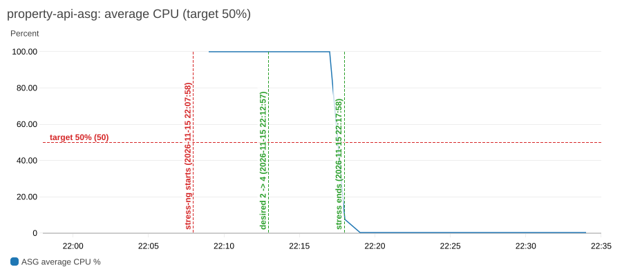
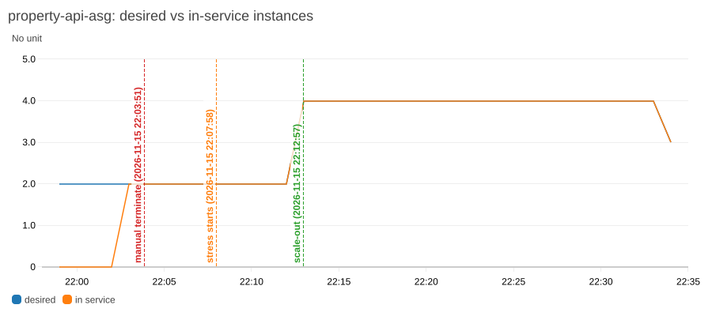

# Week 06 Load Test Report: PropertyLite ASG Scale-Out

**Date:** 2026-11-15 (all times UTC) · **Region:** us-east-2 · **ASG:** `property-api-asg` (min 1 / desired 2 / max 4)
**Policy:** target tracking on `ASGAverageCPUUtilization`, target **50%** · **Instances:** t3.micro, detailed (1-minute) monitoring

## Summary

| | Time (UTC) | Offset |
| --- | --- | --- |
| `stress-ng --cpu 2 --timeout 600` started on both instances (SSM Run Command) | 22:07:58 | 0:00 |
| ASG average CPU first reported at ~100% | 22:09 | +1 min |
| `AlarmHigh` (3 of 3 one-minute datapoints > 50%) → ALARM, desired capacity **2 → 4** | **22:12:57** | **+4 min 59 s** |
| Stress ended, CPU dropped to ~7% then ~0.3% | 22:17:58 | +10:00 |
| `AlarmLow` triggered scale-in, desired **4 → 3** | ~22:33 | +25 min |

**Gap between the CPU spike and the scale-out event: about 4 minutes** after the first above-target datapoint (22:09 → 22:12:57), or **about 5 minutes** after the load started.

## CPU spike

CPU went from idle to a flat **100%** (two `stress-ng` workers on a 2-vCPU t3.micro). Per-minute averages from 22:09 through 22:17 were 99.9 to 100.0%.

## Scale-out event

The graph also shows the **Lab 6.2 self-healing test** at 22:03:51. In-service capacity stayed at 2 because the ASG replaced the terminated instance. At 22:12:57 desired jumped to 4, and both new instances were in service within the same minute. Then capacity held at 4 until the scale-in started.

## Why it took about 4 minutes

1. **Metric resolution.** With detailed monitoring, EC2 publishes CPU every **1 minute**. With the default 5-minute basic monitoring, the same alarm would need about 15 minutes.
2. **Alarm evaluation.** Target tracking's `AlarmHigh` needs **3 consecutive** breaching datapoints. That's the 22:09, 22:10, and 22:11 minutes, plus CloudWatch's ingestion delay of about 1 minute.
3. **Scale amount.** Target tracking sized the jump to bring the average back to 50%. With 2 instances at 100%, that means about 4 instances, so it went straight to max (4) instead of adding 1 at a time.

## Why scale-in was much slower (about 15 min)

`AlarmLow` needs **15 consecutive** datapoints below the target, compared with 3 for `AlarmHigh`. Target tracking deliberately scales **out fast and in slowly** so capacity doesn't flap if load returns.

## Self-healing (Lab 6.2)

| Event | Offset |
| --- | --- |
| `aws ec2 terminate-instances` on 1 of 2 instances | 0 s |
| ASG noticed (EC2 health check), started the replacement | +101 s |
| Replacement passed 2 ALB health checks → **healthy** | **+178 s** |
| ALB `/health` polled every ~10 s during the event | 14 OK, **1 failed** |

The one failure was a request routed to the terminating instance before it finished deregistering. The surviving instance carried all traffic for the rest of the event. In production, a **minimum of 2** keeps one healthy instance while the other is replaced. With `min = 1`, a single bad instance would mean an outage.

## What I'd change for production

- Raise `min` to 2, so the ASG can never scale in to a single point of failure.
- Use an ALB **HTTPS** listener with an ACM certificate instead of plain HTTP:80.
- Add a NAT Gateway per AZ. With one NAT in 2a, instances in 2b lose outbound internet if 2a fails, and the user data can't even install Flask.
- Bake Flask into an AMI (or move to containers in Week 9). New instances currently need about 1.5 minutes of `yum update` + `pip install` before passing health checks, which slows down both scale-out and self-healing.
